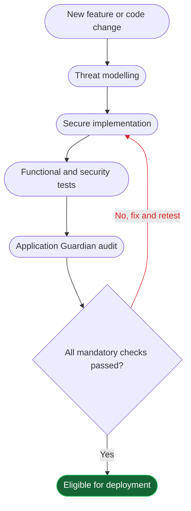

<div align="center">


# Application Guardian

**The production-readiness and security guardian for AI-built applications.**

[](https://github.com/IntellygentAI/application-guardian/actions/workflows/validate.yml)
[](https://github.com/IntellygentAI/application-guardian/actions/workflows/tests.yml)
[](CHANGELOG.md)
[](https://agentskills.io/specification)
[](LICENSE)

[Install](#install) · [Use it](#use-it) · [Release gate](#what-an-audit-produces) · [Roadmap](docs/roadmap/v0.5-upgrade-prompt.md) · [Contributing](#contributing)

</div>

A skill for testing, security, privacy, and production readiness. It tells an agent to review an application the way a QA engineer, an application-security engineer, a database-security reviewer, and a site-reliability engineer would. A successful build, a polished screen, or a happy-path test is not evidence that the application is safe to ship.

Version 0.4.0. The original scenarios are unchanged. This version adds an evidence protocol, a release script, and evaluation fixtures. Agent benchmark scores are not measured. See [docs/benchmarks.md](docs/benchmarks.md).

The skill is technology-independent. Supabase, Firebase, payment providers, and AI integrations are reviewed only when the repository actually uses them.

## Why this matters for AI-generated applications

These are the failures to look for when an AI coding agent wrote or changed the application.

- **Frontend-only security.** The admin control is hidden, and an ordinary user can still call the operation.
- **Incorrect database permissions.** Sign-in works, and any signed-in user can read another user's records because ownership policies are missing.
- **Exposed credentials.** A private AI API key, database credential, or service-role key is included in frontend JavaScript.
- **Unverified payments.** Premium features unlock after the checkout redirect, with no confirmed payment.
- **Exposed private documents.** Invoices, identity documents, and personal uploads sit in public storage.
- **Overprivileged AI agents.** The assistant can reach the whole database or privileged tools. Access has to stay limited to the current user's authorised resources.
- **Race conditions.** Simultaneous requests create duplicate rewards, orders, or charges.
- **String-built queries.** The query returns the right rows, but a search term or sort column is joined into the SQL text instead of bound.
- **False confidence from testing.** The suite passes because it only covers the successful path. It never tries another user, invalid input, or a failed dependency.

### What the research shows

- In a Stanford user study (Perry et al., ACM CCS 2023), [36% of participants with an AI assistant wrote SQL-injectable code on the SQL task, compared with 7% without one](https://arxiv.org/abs/2211.03622). Participants with the assistant were also more likely to believe their code was secure.
- On the SusVibes benchmark of real repository tasks (Zhao et al., ICML 2026), [the best agent produced functionally correct code 57% of the time, but only 11.8% of its solutions were secure](https://icml.cc/virtual/2026/poster/61427). The authors report that security reminders in the prompt did not meaningfully improve that.

Reminders alone do not close the gap. Application Guardian therefore names the concrete code shapes to look for, and computes the release decision from checks that were executed on the current commit.

## How it compares

Several popular skills work alongside this one. They do different jobs.

| | Coding-behaviour skills | Autonomous pentest tools | Static analysis skill sets | Application Guardian |
| --- | --- | --- | --- | --- |
| Examples | [Karpathy-inspired guidelines](https://github.com/forrestchang/andrej-karpathy-skills), [Ponytail](https://github.com/DietrichGebert/ponytail) | [Strix](https://github.com/usestrix/strix) | [Trail of Bits skills](https://github.com/trailofbits/skills) | |
| Job | Shape how the agent writes code: state assumptions, make the smallest change | Attack a running app in a sandbox and prove findings with a proof of concept | Run CodeQL, Semgrep, and variant analysis on source | Decide whether an application is ready to release |
| Output | Smaller, clearer diffs | Validated vulnerabilities | Static findings | Findings, a test matrix, and a computed GO, CONDITIONAL GO, or NO-GO |
| Exploit content | None | Yes, in a sandbox | None | None. Synthetic data, local or authorised staging only |

What Application Guardian adds:

- **A release decision that a script calculates.** `release_gate.py` reads structured evidence. Stale evidence, static-only evidence for a critical control, or a check with no recorded commit cannot produce GO.
- **Real-world behaviour and business logic in the same audit.** Lost connections, double taps, locale and time zone changes, denied permissions, price and coupon abuse, payment verification, and private-data exposure sit next to code-level vulnerability classes.
- **Read-only audits.** Quick Scan, Full Audit, and Release Gate do not change the application. Only Fix and Verify edits code, after you ask.

It works well with the others: a behaviour skill while writing, a static analyser for depth, and Application Guardian before you ship.

## How it fits into development



Yes means the release gate returned GO, or CONDITIONAL GO with the remaining risks explicitly accepted. No sends the change back through secure implementation, tests, and another audit. The skill does not declare an application free of vulnerabilities.

## Install

Manual installation is documented in [docs/installation.md](docs/installation.md). Cursor reads a directory named `application-guardian` that contains `SKILL.md`.

**Every project on this machine**

macOS and Linux:

```bash
git clone https://github.com/IntellygentAI/application-guardian.git ~/.cursor/skills/application-guardian
```

Windows PowerShell:

```powershell
git clone https://github.com/IntellygentAI/application-guardian.git "$env:USERPROFILE\.cursor\skills\application-guardian"
```

**One repository**

From that repository's root:

```bash
git clone https://github.com/IntellygentAI/application-guardian.git .cursor/skills/application-guardian
```

Open a new Agent chat after installing.

The cross-agent command below follows the [Skills CLI](https://github.com/vercel-labs/skills) convention. It has not been executed against this repository:

```bash
npx skills add IntellygentAI/application-guardian
```

Verified and unverified agents are listed in [docs/compatibility.md](docs/compatibility.md). Do not assume an agent can load the skill because it appears in that list.

## Use it

Name the skill and the mode:

| Request | What the agent does |
| --- | --- |
| `Run Application Guardian full audit` | Assess the open application |
| `Run Guardian quick scan` | Review the current change |
| `Run Guardian database security audit` | Check policies, grants, and tenant isolation |
| `Run Guardian payment audit` | Check prices, webhooks, coupons, and entitlements |
| `Run Guardian AI security audit` | Check prompts, tools, data isolation, and cost limits |
| `Run Guardian fix and verify` | Fix confirmed findings and add regression tests |
| `Run Guardian release gate` | Decide GO, CONDITIONAL GO, or NO-GO |

The skill also applies when you create or change a feature, API, authentication flow, permission, database table or policy, file upload, payment, or AI integration, when you install dependencies, review a pull request, fix a bug, or prepare a deployment.

A first assessment defaults to a full audit. Later changes default to a check of the diff and the domains it touches.

## Modes

| Mode | Purpose |
| --- | --- |
| Quick Scan | Obvious security and reliability problems in the recent change |
| Full Audit | Repository and application assessment across every applicable domain |
| Fix and Verify | Remediate confirmed findings and prove the fix with a regression test |
| Release Gate | Production-readiness decision |

The release decision is **GO**, **CONDITIONAL GO**, or **NO-GO**. The skill does not declare an application free of vulnerabilities.

## What an audit produces

In the application repository:

```text
docs/audits/
├── application-audit.md
├── security-findings.md
├── threat-model.md
├── test-matrix.md
├── remediation-plan.md
├── production-readiness.md
└── audit-result.json
```

Create the empty files from the templates:

```bash
python path/to/application-guardian/scripts/scaffold_audit.py --out docs/audits
python path/to/application-guardian/scripts/release_gate.py docs/audits/audit-result.json --head "$(git rev-parse HEAD)"
```


The scaffold script does not overwrite a file that already exists. `release_gate.py` calculates GO, CONDITIONAL GO, or NO-GO from `audit-result.json`. A GO written only in Markdown is not the decision. Exit 0 means GO or CONDITIONAL GO. Exit 1 means NO-GO.

A test is marked PASS only when the report cites evidence. Critical authorisation, tenant, payment, and database-policy checks need runtime evidence. Otherwise the status is FAIL, NOT TESTED, BLOCKED, or NOT APPLICABLE.

## Repository layout

```text
application-guardian/
├── SKILL.md
├── references/
├── templates/
├── schemas/
├── scripts/
├── evals/
├── examples/
└── docs/
```

`SKILL.md` is the operating manual. Each file in `references/` is one domain or one framework. The agent reads a reference only when that domain is in scope. The full map is in [docs/coverage-matrix.md](docs/coverage-matrix.md), and the script layout is in [docs/architecture.md](docs/architecture.md).

| Concern | Where it lives |
| --- | --- |
| Role, invocation, rules, workflow, severity, release decision | `SKILL.md` |
| Input, network, devices, concurrency, accounts, permissions, locale | `references/functional-testing.md` |
| WCAG 2.2 AA | `references/accessibility.md` |
| Authentication, access control, admin privileges, XSS, injection, browser, SSRF | `references/security-testing.md` |
| API inventory and abuse cases | `references/api-security.md` |
| Private data, enumeration, files, secrets, privacy lifecycle | `references/data-privacy.md` |
| Supabase, PostgreSQL, Firebase, integrity, backup | `references/database-security.md` |
| Price, payment, coupons, subscriptions | `references/payment-security.md` |
| Prompt injection, tenant isolation, AI cost | `references/ai-security.md` |
| Dependencies, cloud, rate limits, logging, performance, resilience, tests | `references/production-readiness.md` |
| Authorisation matrix | `templates/test-matrix.md` |
| Audit report and finding schema | `templates/audit-report.md` |
| Threat model | `templates/threat-model.md` |
| Release checklist | `templates/release-checklist.md` |
| Evidence protocol and release script | `references/verification-protocol.md`, `scripts/release_gate.py` |
| Mobile, MCP, supply chain | `references/mobile-security.md`, `references/agent-mcp-security.md`, `references/supply-chain-security.md` |
| Framework notes | `references/framework-specific/` |
| Evaluation fixtures | `evals/` |

## Limits

Adversarial checks use synthetic accounts, fictional data, and a local or authorised staging environment.

The skill does not:

- attack production or a third-party system without explicit authorisation
- print secret values or private customer data in a report
- deploy, rotate production credentials, change live data, or run a destructive migration unless you explicitly approve that action
- treat a hidden button, an unpredictable ID, a checkout redirect, or a public client key as a security control
- edit the application during Quick Scan, Full Audit, or Release Gate
- treat a measured detection rate as known. Those numbers are not measured

Security checks belong at the backend, database, and infrastructure boundary. Frontend validation is not enough.

A fictional completed audit is in [examples/sample-audit.md](examples/sample-audit.md). It is sample data, not a review of a real customer.

## Contributing

See [CONTRIBUTING.md](CONTRIBUTING.md), [AGENTS.md](AGENTS.md), and [SECURITY.md](SECURITY.md). The change history is [CHANGELOG.md](CHANGELOG.md). Architecture and the coverage map are in [docs/architecture.md](docs/architecture.md) and [docs/coverage-matrix.md](docs/coverage-matrix.md).

Suggested GitHub topics, once a maintainer with admin access applies them: `agent-skills`, `ai-agents`, `vibe-coding`, `application-security`, `appsec`, `devsecops`, `owasp`, `security-audit`, `automated-testing`, `production-readiness`, `cursor`, `claude-code`, `codex`, `supabase`, `llm-security`, `qa-automation`, `secure-coding`, `mcp`.

## Standards

The checklists follow current guidance from:

- [OWASP ASVS](https://owasp.org/projects/asvs/)
- [OWASP Web Security Testing Guide](https://owasp.org/www-project-web-security-testing-guide/)
- [OWASP API Security](https://owasp.org/projects/api-security/)
- [OWASP Cheat Sheet Series](https://cheatsheetseries.owasp.org/)
- [OWASP GenAI Security](https://genai.owasp.org/)
- [CWE](https://cwe.mitre.org/)
- [NIST Secure Software Development Framework](https://csrc.nist.gov/projects/ssdf)
- [WCAG 2.2](https://www.w3.org/TR/WCAG22/)
- [Supabase Security](https://supabase.com/docs/guides/security)
- [Stripe](https://docs.stripe.com/)
- [Firebase Security Rules](https://firebase.google.com/docs/rules)

Framework-specific advice is checked against the version in the repository being reviewed.

## License

[MIT](LICENSE). Copyright (c) 2026 IntellygentAI.
