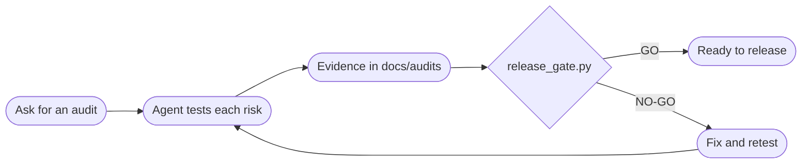

<div align="center">



# Application Guardian

**Security and release checks for applications built with AI coding agents.**

[](https://github.com/IntellygentAI/application-guardian/actions/workflows/validate.yml)
[](https://github.com/IntellygentAI/application-guardian/actions/workflows/tests.yml)
[](CHANGELOG.md)
[](https://agentskills.io/specification)
[](LICENSE)

[Install](#install) · [Use it](#use-it) · [Release gate](#the-release-gate) · [Results](docs/benchmarks.md) · [Contributing](#contributing)

</div>

Application Guardian is an agent skill. Install it, and your coding agent reviews an application before release: who can read whose data, whether prices and payments are checked on the server, what happens when the network drops or a user taps twice, and whether secrets reach the browser. It writes the findings to `docs/audits/` and a script decides whether the release can go out.

It works with any stack. Supabase, Firebase, Stripe, Next.js, Django, and FastAPI get extra checks when the repository uses them.

## How it works

1. You ask your agent for a scan or an audit.
2. The agent works out your stack and reads only the checklists that apply to it.
3. It tries each risk the way a real user could: a second account, the same request sent twice, a dropped connection. It records what it ran and what came back.
4. It writes the findings to `docs/audits/`.
5. `release_gate.py` reads that evidence and returns GO, CONDITIONAL GO, or NO-GO. On NO-GO you fix, retest, and run the gate again.



## Why it exists

Apps written by AI coding agents often look finished and pass their own tests. The gaps are usually on the server, where nothing shows on screen. Two studies show the size of the problem:

- In a Stanford user study (Perry et al., ACM CCS 2023), [36% of participants with an AI assistant wrote SQL-injectable code on the SQL task, compared with 7% without one](https://arxiv.org/abs/2211.03622). They were also more likely to believe their code was secure.
- On the SusVibes benchmark of real repository tasks (Zhao et al., ICML 2026), [the best agent produced working code 57% of the time, but only 11.8% of its solutions were secure](https://icml.cc/virtual/2026/poster/61427). Adding security reminders to the prompt did not help much.

Asking the agent to be careful is not enough. Application Guardian tells it exactly which code patterns to look for, and a release only passes when the checks ran on the code you are about to ship.

## What it checks

**Access**
- One user reading or changing another user's records, invoices, files, or messages
- Admin actions that are hidden in the interface but still callable
- Database rules that let any signed-in user read every row

**Secrets and private data**
- Secret keys in frontend code, built bundles, or Git history
- Private uploads in public storage
- AI assistants that can reach data the current user cannot

**Money**
- Prices, quantities, and payment status taken from the browser
- Paid features unlocked by the checkout page instead of a confirmed payment from the provider
- Coupons, credits, and sign-up bonuses used twice by sending requests at the same moment

**Code and tests**
- SQL built by joining strings, including sort columns taken from the request
- Tests that only cover the happy path and never try another user, bad input, or a failed service

**Real-world use**
- Lost connections, double taps, very long input, other languages, time zones, denied permissions, and screen readers

The full checklists are in `references/`. Each file covers one area, and the agent reads it only when that area applies.

## The release gate

The agent does not decide whether to release. `scripts/release_gate.py` reads `docs/audits/audit-result.json` and prints GO, CONDITIONAL GO, or NO-GO.



It returns NO-GO when:

- a critical or high finding is open, or was marked fixed without a passing test on the current commit
- any of the [25 mandatory checks](schemas/mandatory-checks.json) is missing, failed, or not run
- a check passed without a recorded command, exit code, result, and commit
- a critical check passed on code review alone, without a test that ran
- the evidence was recorded on a different commit, or there are uncommitted changes
- an accepted risk has no owner and approver, or is high or critical

CONDITIONAL GO means only medium or low risks remain, and each was accepted by a named person. A GO written in a report does not count. Only the script's output does.

## Install

With the Skills CLI, from your project:

```bash
npx skills add IntellygentAI/application-guardian
```

This puts the skill in `.agents/skills/` for Cursor, Codex, GitHub Copilot, and Gemini CLI, and links it into `.claude/skills/` for Claude Code.

Or clone it into your agent's skills folder. For Cursor:

```bash
git clone https://github.com/IntellygentAI/application-guardian.git ~/.cursor/skills/application-guardian
```

More options are in [docs/installation.md](docs/installation.md). The scripts need Python 3.11 or newer and nothing else.

## Use it

Ask your agent:

| Request | What happens |
| --- | --- |
| `Run Guardian quick scan` | Checks the current change and the areas it touches |
| `Run Application Guardian full audit` | Checks the whole application |
| `Run Guardian database security audit` | Who can read and write each table, and whether customers' data stays separate |
| `Run Guardian payment audit` | Prices, payment confirmations, coupons, and access to paid features |
| `Run Guardian AI security audit` | Prompts, tools, data access, and cost limits |
| `Run Guardian fix and verify` | Fixes confirmed findings and adds a test for each |
| `Run Guardian release gate` | Runs the gate and reports the decision |

Scans and audits only read the code. Only fix and verify changes it, and only after you ask.

The first run on a repository is a full audit. After that, the agent checks each change.

## What an audit produces

```text
docs/audits/
├── application-audit.md      summary, scope, and decision
├── security-findings.md      each finding with file, line, and fix
├── threat-model.md
├── test-matrix.md            who can do what, allowed and denied
├── remediation-plan.md
├── production-readiness.md   the 25 mandatory checks
└── audit-result.json         the evidence the gate reads
```

Create them yourself, and run the gate:

```bash
python path/to/application-guardian/scripts/scaffold_audit.py --out docs/audits
python path/to/application-guardian/scripts/release_gate.py docs/audits/audit-result.json
```

The scaffold never overwrites a file. The gate exits 0 for GO or CONDITIONAL GO and 1 for NO-GO, so it can block a CI job.

A worked example with fictional data is in [examples/sample-audit.md](examples/sample-audit.md).

## Results

On 2026-11-26 the skill was tested against the same agent without it, on 18 small cases, three runs each. Both found every defect. With the skill, the agent also said that reading code is not enough to pass a check, and it ran the gate on audit files. Without the skill, it did neither. The skill used about 25% more tokens. The cases, every answer, and the grading script are in [docs/benchmarks.md](docs/benchmarks.md).

## Limits

- Tests run only against local or authorised staging environments, with made-up accounts and data. The skill does not attack production or anyone else's system.
- It does not print secret values or customer data in reports.
- It does not deploy, rotate credentials, change live data, or run destructive migrations without your approval.
- A GO is not proof that the application has no vulnerabilities. It means the mandatory checks ran and passed on that commit.

## Repository layout

| Path | Contents |
| --- | --- |
| `SKILL.md` | What the agent reads first: modes, rules, and the audit steps |
| `references/` | Checks for each area and framework |
| `scripts/` | Release gate, report validator, stack detector, scaffold |
| `schemas/` | Audit format and the mandatory check list |
| `templates/` | Report templates |
| `evals/` | Test cases and benchmark results |
| `docs/` | Installation, compatibility, architecture, roadmap |

## Contributing

See [CONTRIBUTING.md](CONTRIBUTING.md) and [AGENTS.md](AGENTS.md). Report a security problem as described in [SECURITY.md](SECURITY.md). Changes are listed in [CHANGELOG.md](CHANGELOG.md).

## Standards

The checks draw on [OWASP ASVS](https://owasp.org/projects/asvs/), the [OWASP Web Security Testing Guide](https://owasp.org/www-project-web-security-testing-guide/), [OWASP API Security](https://owasp.org/projects/api-security/), the [OWASP Cheat Sheet Series](https://cheatsheetseries.owasp.org/), [OWASP GenAI Security](https://genai.owasp.org/), [CWE](https://cwe.mitre.org/), the [NIST SSDF](https://csrc.nist.gov/projects/ssdf), and [WCAG 2.2](https://www.w3.org/TR/WCAG22/), plus the security documentation for [Supabase](https://supabase.com/docs/guides/security), [Stripe](https://docs.stripe.com/), and [Firebase](https://firebase.google.com/docs/rules).

## License

[MIT](LICENSE). Copyright (c) 2026 IntellygentAI.

Made by [Intellygent AI](https://intellygent.ai/) in London.
