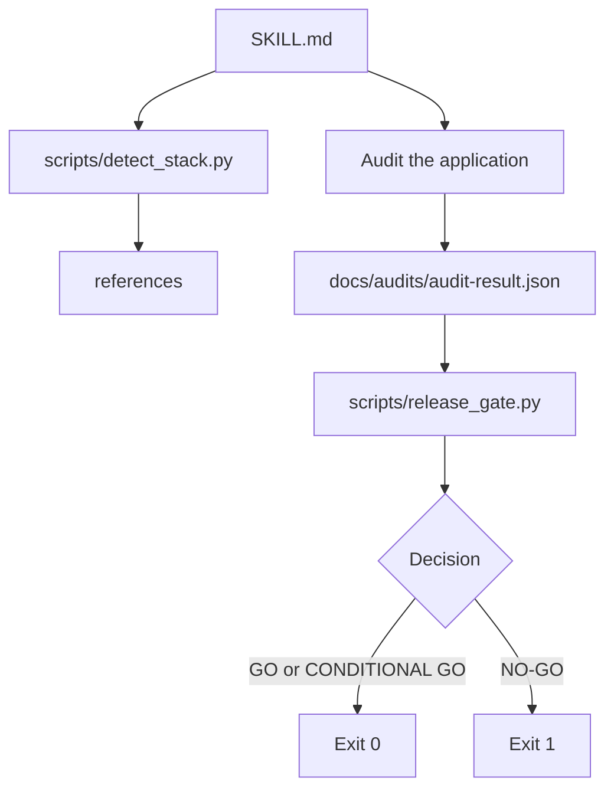

# Architecture

Application Guardian is one skill with a short entry point. Domain detail stays in reference files that the agent reads when the stack or the mode needs them.

| Piece | Role |
| --- | --- |
| `SKILL.md` | When to run, mode boundaries, and where to look |
| `references/` | Checks for one domain or one framework |
| `templates/` | Empty Markdown reports and one finding object |
| `schemas/` | The JSON shape of an audit and a finding, and the 25 mandatory release checks |
| `scripts/validate_skill.py` | Frontmatter, required files, and relative links |
| `scripts/detect_stack.py` | Which framework reference to open |
| `scripts/scaffold_audit.py` | Creates `docs/audits` without overwriting |
| `scripts/validate_report.py` | Checks an audit JSON file against the schema |
| `scripts/release_gate.py` | Calculates GO, CONDITIONAL GO, or NO-GO |
| `scripts/ci_evidence.py` | Re-runs the recorded commands in CI and writes evidence the gate can check |
| `templates/ci/` | A GitHub Actions workflow and a CODEOWNERS file for running the gate in CI |
| `evals/` | Synthetic fixtures, expected findings, and the with-and-without benchmark in `evals/benchmark/` |

Quick Scan, Full Audit, and Release Gate do not edit the application. Fix and Verify edits only a confirmed finding, and only when remediation was requested.

The release script ignores a GO written in Markdown. It reads `audit-result.json`.
